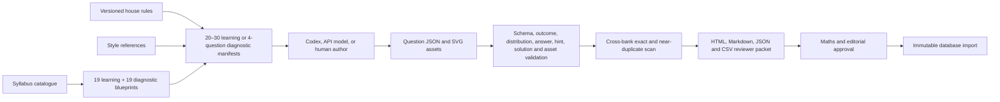

# Bulk question-authoring pipeline

## What the pipeline is

The pipeline is the controlled workflow around authored question JSON. A JSON Schema is one component: it describes the allowed shape of a blueprint, batch manifest, house-rules file, or question. The pipeline also creates work allocations, records provenance, runs executable checks, detects duplicates, and packages content for human review.



Question generation is deliberately separate from runtime student requests. Models or authors create repository files in claimed batches; the Learning API serves only validated, reviewed, imported revisions.

## Repository layout

```text
backend_resources/question_bank/
  authoring/house-rules-v1.json
  schema/question-batch-manifest-v1.schema.json
  schema/question-house-rules-v1.schema.json
  g3_math/<school_level>/<topic>/<v1-learning-or-v2-diagnostic>/
    blueprint.json
    batches/<batch-id>.json
    questions/<stable-key>.json
    assets/*
```

All 19 level-specific topic groups have 104-question target blueprints. The original 40 N1 calibration questions occupy their matching blueprint cells, and batches B001–B003 now supply the remaining 64 questions in groups of 22, 21, and 21. Each of the other 18 banks is split into four 26-question manifests. The completed catalogue therefore contains 1,976 authored questions.

The Secondary 1 N2 calibration bank is complete and approved. Secondary 1 N3 through N7, G1, G5 and S1,
and every Secondary 2 topic group each contain all 104 planned questions, complete lesson notes and pool
allocations, and remain gated for Mathematics and editorial review. Secondary 1 N1 also contains its
complete 104-question draft bank and deterministic lesson, checkpoint and reserve allocations. The
repository therefore contains 1,976 authored learning questions across all 19 topic-level
banks. A separate version-2 diagnostic bank for every topic group reserves 76 unwritten
questions: two baseline and two endline items per group.

## Commands

From the repository root:

```bash
uv run --project question_bank question-bank authoring-schema
uv run --project question_bank question-bank authoring-blueprints
uv run --project question_bank question-bank authoring-plan
uv run --project question_bank question-bank authoring-validate
```

Create or verify the diagnostic blueprints and exact four-question manifests from the tracked
38+38 source plan:

```bash
uv run --project question_bank question-bank diagnostic-authoring-plan
uv run --project question_bank question-bank authoring-next \
  --owner YOUR_GITHUB_USERNAME --bank-role diagnostic
```

Select the next unclaimed planned batch and package its exact generation contract:

```bash
uv run --project question_bank question-bank authoring-next \
  --owner YOUR_GITHUB_USERNAME --school-level secondary_2 --topic G4
uv run --project question_bank question-bank authoring-work-order \
  PATH/TO/BATCH.json build/authoring-work-orders/BATCH_ID
```

`authoring-work-order` produces `prompt.md`, `work-order.json` and
`response-template.json`. It resolves the exact checksum-tracked house-rules file from the
manifest. Codex, an API model or a human author therefore receives the same stable-key,
outcome, difficulty, schema, house-rule and source-reference contract.

On the batch's active claimed branch, the executor can call OpenAI Structured Outputs and
materialise a complete batch:

```bash
export OPENAI_API_KEY=...
uv run --project question_bank question-bank authoring-execute \
  build/authoring-work-orders/BATCH_ID/work-order.json \
  --provider openai --model YOUR_APPROVED_MODEL
```

It verifies the active claim before any paid call, retries deterministically invalid output at
most twice, validates slots, answers, assets and duplicates, and performs transactional writes.
Success advances the manifest to `ready_for_review`, creates the reviewer packet and writes an
execution report. Mathematics and editorial decisions remain pending. A saved response can be
rehearsed without writing by using `--provider response-file --response-file questions.json
--recorded-provider openai --model YOUR_APPROVED_MODEL --dry-run` so the eventual manifest
records the content generator rather than the file adapter.

Export an authored batch after its manifest lists all generated question keys:

```bash
uv run --project question_bank question-bank authoring-export \
  backend_resources/question_bank/g3_math/secondary_1/n2/v1/batches/g3-sec1-n2-b001.json \
  backend_resources/question_bank/g3_math/secondary_1/n2/v1/review_packets/g3-sec1-n2-b001
```

The export contains `index.html`, editable `review.md` and `review.csv` files, the
manifest, source question JSON, validation evidence, and referenced assets. These are
portable fallback and audit artifacts. The normal collaborative review surface is the
protected `/admin/content` dashboard, where reviewers can filter by batch, inspect full
answers/hints/solutions and record append-only Mathematics and editorial decisions.

The shared deployment and contribution workflow is documented in
[SHARED_CONTENT_REVIEW_STAGING.md](SHARED_CONTENT_REVIEW_STAGING.md).

## Batch lifecycle

1. `planned`: exact outcome/difficulty allocation and stable keys exist; generator fields may be `unassigned`.
2. `draft`: all allocated keys exist—20–30 for learning or exactly four for diagnostic—and concrete provider, model, generator version, and prompt version are recorded.
3. `ready_for_review`: automated validation succeeds and the packet is exported.
4. `changes_requested`: reviewer corrections are required.
5. `approved`: mathematics and editorial decisions are both approved.

A batch cannot move beyond `planned` with missing question keys or placeholder generator metadata. An `approved` manifest cannot retain pending review decisions.

## Validation boundary

The authoring validator checks:

- complete learning blueprint coverage of all 19 syllabus topic groups and, when diagnostics are present, diagnostic coverage of the same 19 groups;
- exact diagnostic keys and allocations against the checksum-tracked 38+38 plan;
- exact aggregate batch coverage of every blueprint outcome and difficulty cell;
- unique batch IDs and exclusive question ownership;
- source-reference checksums;
- question schema, bank, curriculum, topic and outcome alignment;
- exactly two ordered hints and internally consistent solution marks through the question model;
- canonical and explicitly accepted answers by executing the deterministic checker;
- referenced asset existence and SHA-256 checksums;
- exact prompt duplicates as errors; and
- number-normalised near-prompt matches as reviewer warnings.

Near-duplicate warnings are evidence for a reviewer because similarity can be legitimate in short procedural questions. Exact duplicates fail validation.

## Parallel Codex authoring

Each contributor claims one manifest in the versioned claim registry, updates its
generator metadata, works on the exact registered branch, and authors only the allocated
cells. Pull-request CI rejects missing or mismatched claims, multi-batch changes and
unallocated files. It also runs aggregate validation and uploads reviewer evidence. The
manifest remains the content-allocation contract, while the registry is the coordination
contract, so contributors do not depend on shared conversation memory.

See [MULTI_AUTHOR_QUESTION_PIPELINE.md](MULTI_AUTHOR_QUESTION_PIPELINE.md) for commands,
branch sequencing, CI evidence and claim release.

Additional examination papers can be added as checksum-tracked style references later. They improve calibration but are not needed to build or exercise this workflow.
