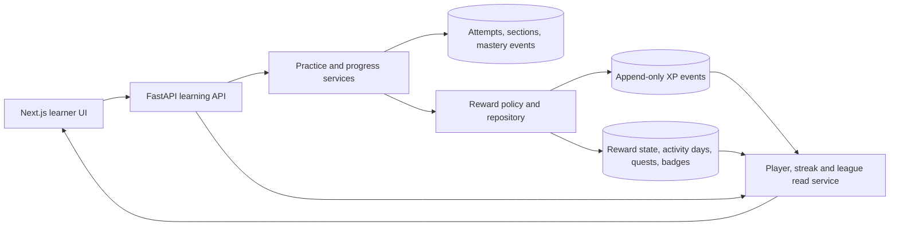

# Layer 2 gamification architecture

**Status:** proposed architecture, 12 October 2026  
**Scope:** experience points, levels, streak calendar, streak freezes, weekly leaderboard, quests, badges, wardrobe unlocks and celebrations  
**Product phase:** Layer 2 Beta; independent of the Mathematics content-production path

## Feasibility decision

This system is feasible with the existing NextScholar architecture. The frontend kit already contains the intended player, XP, streak, quest, league, badge and wardrobe screens. The current learning API already records the academic events needed to award most rewards: answer attempts, hint use, retry-review state, section completion and checkpoint mastery.

The remaining work is a medium-sized backend and integration project. It does not require an LLM or paid model tokens. At Beta scale it can run on the existing FastAPI and PostgreSQL stack without a separate microservice, queue or paid scheduler.

The main difficulty is correctness rather than visual implementation. XP must be awarded once, by the server, even when a request is retried. Streaks must use a defined calendar boundary. Leaderboards must exclude hidden learners and resist repetitive farming. The design below addresses those cases.

The recommended sequence is to preserve this design now, continue N5 and the Layer 1 Mathematics catalogue, and implement gamification as a separate Layer 2 branch. Building it does not need to block content authoring or review.

## Existing foundation

The proposed UI and reward rules are documented in [`apps/web/src/beta-kit/HANDOFF.md`](../../apps/web/src/beta-kit/HANDOFF.md). Its typed view models are in [`apps/web/src/beta-kit/types.ts`](../../apps/web/src/beta-kit/types.ts), and the sample state currently displayed by the preview is in [`apps/web/src/beta-kit/sample-data.ts`](../../apps/web/src/beta-kit/sample-data.ts).

The repository already provides:

- idempotent practice-session and attempt writes;
- server-checked answers and recorded attempt numbers;
- recorded hint stages and tutor sessions linked to a question;
- retry-review scheduling and checkpoint modes;
- immutable mastery events;
- lesson-section completion and active-recall checking;
- authenticated learner identities, enrolments and PostgreSQL row-level security;
- responsive XP, streak, league, progress, badge and celebration components using sample data.

The missing part is an authoritative rewards domain that turns those academic records into the view models expected by the UI.

## Product rules

### Principles

1. **Learning actions earn rewards.** Time spent, rapid clicking and tutor chatting do not earn XP.
2. **Mistakes never remove XP.** A wrong answer may schedule review, but it does not reduce a learner's total.
3. **Help remains safe to use.** A correct answer after a hint, retry or tutor help still earns XP, at a lower rate than an unassisted first answer.
4. **No reward is trusted from the browser.** The API derives rewards from committed academic records.
5. **Every award is idempotent.** Replaying a request returns the original award instead of creating another one.
6. **Competition is optional and privacy-conscious.** Learners may hide themselves from the league without losing personal XP, levels or streaks.
7. **XP has no cash value.** It cannot be bought, transferred or redeemed. Cosmetics do not affect learning access or marks.

### Initial XP table

These values implement the intent in the frontend handoff. They should be versioned in server code so future tuning does not rewrite historical events.

| Rule key | Award | Conditions | Streak day | League score |
| --- | ---: | --- | :---: | :---: |
| `practice_first_try_correct` | 10 | Guided or checkpoint answer is correct on attempt 1, with no hint or tutor help | Yes | Yes |
| `practice_assisted_correct` | 6 | Correct after a wrong attempt, hint or tutor help | Yes | Yes |
| `retry_review_cleared` | 20 | A due spaced-review item is resolved correctly; once per review cycle | Yes | Yes |
| `lesson_section_completed` | 10 | First completion of an ordinary section revision | Yes | Yes |
| `active_recall_correct` | 5 | First correct completion of an active-recall section revision | Yes | Yes |
| `video_completed` | 10 | First server-accepted completion of at least 90%; deferred until videos exist | Yes | Yes |
| `daily_quest_completed` | 15 | One assigned daily quest reaches its target | No | Yes |
| `daily_quest_board_completed` | 30 | All three quests are completed on the assigned local date | No | Yes |
| `unit_mastered` | 100 | First immutable mastery event for the course/unit revision | Yes | Yes |
| `recheck_passed` | 50 | First pass of the future two-week recheck | Yes | Yes |
| `essay_submitted` | 30 | First locked submission of an essay version; deferred with English | Yes | Yes |
| `essay_improved` | 20 | A later locked version satisfies the defined improvement rule | Yes | Yes |
| `confirmed_problem_report` | 25 | An administrator confirms a valid report | No | No |
| `weekly_checkin_completed` | 20 | One completed weekly reflection | No | No |
| `onboarding_welcome` | 50 | Once after invitation acceptance | No | No |
| `streak_milestone` | configured | Once at 3, 7, 14, 30 and 60 days | No | No |

An active-recall section may create both `lesson_section_completed` and `active_recall_correct` if the product retains the separate “section” and “check yourself” rewards shown in the UI. Both events remain independently deduplicated.

Diagnostics should not award competitive XP. Their purpose is to measure an unaided baseline or endline, and a reward could encourage rushing. Tutor messages never award XP. A subsequent correct answer is classified as assisted when eligible tutor activity occurred before that attempt, matching the rule in [`apps/web/src/beta-kit/tutor/TUTOR.md`](../../apps/web/src/beta-kit/tutor/TUTOR.md).

### Levels and rank titles

`xp_total` is the source for level calculation. `level`, `xp_into_level` and `xp_for_level` are derived fields and must never drift independently.

For the first pilot, use a versioned threshold table with 160 XP per level. The value is already presented by the sample UI and is easy for learners to understand. It should be reviewed after observing two weeks of real Beta earning rates; changing the curve changes future display calculations, not the immutable XP ledger.

The rank bands already designed in the UI remain:

| Levels | Rank title |
| --- | --- |
| 1–4 | Applicant |
| 5–9 | Test-taker |
| 10–14 | Shortlisted |
| 15–19 | Interviewee |
| 20+ | Scholar |

The preview values are illustrative and may not currently agree with the final threshold calculation. When the live adapter replaces sample data, all displayed level fields must come from one server calculation.

## Streak calendar

### What qualifies

A local calendar day becomes `done` after the first XP event whose rule counts toward a streak. Quest bonuses, milestone bonuses, onboarding, reports and weekly check-ins cannot create a study day by themselves.

For the first Beta, use `Asia/Singapore`, which the live UI already uses. A later migration may add an IANA time-zone field to the learner profile. Each XP event stores the server-calculated local activity date and time-zone snapshot, so a later preference change cannot move old activity between days.

### Current streak

- A streak is the number of consecutive `done` or protected `freeze` dates ending today.
- Before the learner studies today, a sequence ending yesterday remains the current streak.
- A future day is `empty`; the current date is `today` until it qualifies.
- The best streak records the greatest historical consecutive sequence.
- Missing more dates than the available freeze balance breaks the streak.

### Freezes

- Completing learning activity on 5 distinct days in one Monday–Sunday week earns one freeze.
- A learner can hold at most 2 freezes.
- A freeze is never sold and cannot be manually placed to rewrite history.
- The server automatically consumes a freeze for the earliest eligible missed date when it next reconciles the streak.
- A frozen date preserves continuity but earns no XP and does not count as an active day toward another freeze.

No midnight job is required. Streak rollover can be materialized lazily when the learner performs a qualifying action or loads the dashboard. This keeps the first Beta compatible with free hosting plans. Reminder notifications are a separate future capability and would require an email, push or scheduled-delivery service.

## Weekly Beta League

The first release uses one league for the invited Beta cohort.

- A league week runs Monday 00:00 through the following Monday 00:00 in `Asia/Singapore`.
- Only learners who explicitly enable **Show me in the Beta League** appear.
- The default should be hidden until the learner opts in.
- Entries show the chosen display name in abbreviated form, such as `Dimas S.`, and never expose email addresses.
- The board is hidden when fewer than 5 learners opt in, because a very small board reveals too much about individual activity.
- A learner's weekly league score is the sum of eligible events, capped at 200 league XP per local day. Personal lifetime XP still includes valid awards above that cap.
- Equal scores receive the same visible rank. The earlier time at which the score was reached supplies a stable display order without changing the tied rank.
- The top three receive the designed crown treatment for the following league week. Academic content, tutor access and marks never depend on league position.
- Opting out removes the learner from subsequent responses immediately and sets `league_rank` to `null`; historical XP remains intact.

The daily competitive cap and absence of speed rewards reduce pressure to grind. During the pilot, monitor whether league participation harms practice quality or discourages lower-ranked learners. The league can be disabled independently while XP and streaks remain active.

## Quests, badges and cosmetics

Daily quests are deterministic assignments, not random client choices. The server selects three achievable templates for the learner's available work. It must not assign “clear two reviews” when no reviews are due.

Quest progress is derived from the same event stream used for XP. Completing a quest emits one deduplicated XP event, and completing all three emits the board bonus. Quest bonuses cannot progress another quest or create a streak day.

Badge definitions are versioned configuration. Badge unlocks are append-only facts. Useful initial badges are already represented in the kit: First-try ace, Comeback kid, On fire, Prime time, Review master, Quest hunter, Number master and Two weeks strong.

Wardrobe items are cosmetic unlocks. Equipping an item changes only the learner's game profile. The server verifies that the item is unlocked before accepting the selection.

Celebrations are durable, one-time notifications generated by events such as a level increase, streak milestone, unit mastery or badge unlock. The API returns unseen celebrations and records `seen_at` after the learner dismisses them. This prevents repeated full-screen celebrations after refresh.

## Architecture

Gamification should be a module inside the existing learning API for the Beta. A separate service would add deployment and consistency costs without providing a benefit at the current scale.



For an answer submission, the attempt and its XP event should commit in the same PostgreSQL transaction. The insertion point is the existing locked transaction in `PostgresPracticeEngine.submit_attempt`. Section rewards belong in the transaction that first inserts section completion. Mastery rewards belong where immutable mastery events are inserted.

The first implementation should avoid a generic event bus. Direct domain calls are easier to reason about and test. An outbox can be added later if notifications or analytics require asynchronous processing.

### Proposed tables

| Table | Purpose and important fields |
| --- | --- |
| `learner_game_profiles` | One row per learner: time zone, league visibility, sound/celebration/reminder settings and equipped outfit. |
| `xp_events` | Append-only source of truth: learner, amount, rule key/version, source type/id, event time, local activity date, streak/league eligibility, metadata and optional reversal reference. A unique learner/rule/source constraint enforces one award. |
| `learner_reward_state` | Rebuildable read model: total XP, current/best streak, freeze balance and last processed date. Updated in the reward transaction, but never treated as historical evidence. |
| `learner_activity_days` | One row per learner/local date with `done` or `freeze`, qualifying event count, earned XP and time-zone snapshot. |
| `league_weeks` | Week boundaries, label and status. The Beta leaderboard may aggregate `xp_events` directly; this table stabilizes week identity and rewards. |
| `daily_quest_assignments` | Learner/date/template/version, target, progress, completion time and reward event ID. |
| `badge_definitions` | Versioned badge metadata and evaluation rule key. |
| `learner_badges` | Append-only learner/badge unlocks with source evidence. |
| `reward_notifications` | Durable level, streak, mastery and badge celebrations with `seen_at`. |

PostgreSQL triggers should reject updates and deletes on `xp_events` and `learner_badges`, following the existing immutable mastery-event pattern. A mistaken award is corrected with a linked compensating event and an administrator audit record.

Authenticated clients receive read access only to their own game profile, XP history, activity days, quests, badges and notifications. They receive leaderboard rows only through the learning API, which applies visibility and name-redaction rules. Clients never receive insert permission for reward tables.

### API contracts

The smallest useful API surface is:

| Method | Route | Result |
| --- | --- | --- |
| `GET` | `/api/v1/gamification/home` | Player summary, current streak week, quest board, league preview and unseen celebrations in one dashboard request. |
| `GET` | `/api/v1/gamification/xp-events` | Cursor-paginated recent XP ledger for the progress screen. |
| `GET` | `/api/v1/gamification/streak?month=YYYY-MM` | Month calendar, current/best streak, freeze balance and milestones. |
| `GET` | `/api/v1/gamification/league/current` | Sanitized current board, learner chase data and week boundary. |
| `GET` | `/api/v1/gamification/badges` | Earned badges and safe progress toward incomplete badges. |
| `PATCH` | `/api/v1/gamification/settings` | League visibility, sounds, celebrations, reminder preference and time. |
| `PUT` | `/api/v1/gamification/outfit` | Equip one already-unlocked cosmetic. |
| `POST` | `/api/v1/gamification/celebrations/{event_id}/seen` | Idempotently dismiss one celebration. |

Existing learning mutations should return a `rewards` envelope rather than requiring the browser to call an “award XP” route:

```json
{
  "xp_earned": 10,
  "xp_total": 1250,
  "level_before": 7,
  "level_after": 7,
  "streak_days": 13,
  "quest_updates": [],
  "celebration_ids": []
}
```

`GET /learning-home` may embed the same gamification home payload after the live dashboard is wired, avoiding an extra request. The standalone route remains useful for progress, league and settings pages.

## Idempotency and abuse controls

- XP insertion uses a database unique key such as `(student_id, rule_key, source_type, source_id)`.
- Replaying an attempt idempotency key returns the same attempt and reward envelope.
- Repeating a completed question in a new ordinary practice session does not farm the original completion award. A later scheduled review has a distinct review-cycle source and may earn its review reward once.
- Toggling a lesson section off and on cannot re-award its first-completion XP.
- Checkpoint-question XP is awarded once per learner/question revision/checkpoint context; checkpoint retakes cannot farm it.
- Quest, milestone, badge and league-prize events never recursively progress quests or streak activity.
- The league calculation applies its daily cap on the server.
- Reward adjustments require an academic administrator, a reason and an immutable audit record.
- Rate-limit and security-event patterns can reuse the repository's existing API abuse controls.

## Reconciliation and observability

The ledger must be independently recomputable. Add an administrator-only reconciliation command that derives XP totals, streaks and badge unlocks from immutable events and reports differences from cached read models. It should default to read-only and require an explicit flag to repair state.

Track at least:

- XP awards created, deduplicated and reversed by rule;
- reward-transaction failures;
- read-model reconciliation mismatches;
- opted-in league population;
- streak and freeze distributions;
- XP per active learner and per academic question;
- first-try accuracy and eventual accuracy alongside XP, so increased engagement is not mistaken for improved learning.

Alert on unusual award rates, repeated idempotency conflicts or one learner reaching the league cap unusually quickly.

## Testing requirements

1. Unit-test every rule boundary, including first attempt, later attempt, hint use, tutor use, retry mode and checkpoint retake.
2. Prove duplicate HTTP submissions and concurrent submissions produce one XP event.
3. Test month/year boundaries, Monday league rollover, streaks ending yesterday, two missed dates, freeze exhaustion and profile time-zone changes.
4. Test league opt-in/out, minimum cohort size, daily cap, ties and redacted display names.
5. Test that clients cannot insert rewards or read another learner's private ledger through RLS.
6. Recompute read models from the ledger in PostgreSQL integration tests.
7. Add frontend contract tests for the real `Player`, `StreakWeek`, `QuestBoard` and `League` adapters.
8. Add authenticated browser journeys for earning XP, preserving a streak, opting into the league and seeing a one-time celebration.
9. Run account-deletion coverage to confirm reward data is removed with the learner.

## Delivery plan

### G1 — Ledger and player vertical slice

- Add the migration, reward policy, repository and contracts.
- Award +10/+6/+20 from practice transactions.
- Expose player totals and recent XP events.
- Wire the top-bar XP and level components behind `ASEAN_ACADEMY_GAMIFICATION`.

**Exit:** one correct answer produces one durable award under retries and refreshes.

### G2 — Streak calendar and settings

- Materialize activity days, streak totals and earned freezes.
- Add the month endpoint and settings endpoint.
- Wire the streak chip, dashboard week and streak screen.

**Exit:** calendar rollover and freeze cases pass server and browser tests.

### G3 — Weekly Beta League

- Add league visibility, current-week query, redacted names, minimum cohort and daily cap.
- Wire the dashboard league card and full league screen.

**Exit:** hidden learners never appear, ties are deterministic and the week rolls over correctly.

### G4 — Quests, badges, wardrobe and celebrations

- Add deterministic quest assignment and progress.
- Add badge unlocks, cosmetics and one-time celebration delivery.
- Wire the remaining existing kit screens.

**Exit:** all sample-data reward screens use live contracts and no client can manufacture progress.

### G5 — Pilot hardening

- Add reconciliation, administrator evidence, metrics and load tests.
- Measure engagement and learning quality during an invite-only cohort.
- Tune XP thresholds and league caps through a new rule version only after reviewing evidence.

**Exit:** the feature can be enabled or disabled independently without changing academic progress.

## Effort and cost

For one developer familiar with this repository, a careful implementation is approximately 18–25 development days:

| Work | Estimate |
| --- | ---: |
| Ledger, policies, migrations and practice integration | 4–6 days |
| Player, levels, settings and streaks | 4–5 days |
| Leaderboard and privacy/abuse controls | 3–4 days |
| Quests, badges, cosmetics and celebrations | 4–6 days |
| Hosted integration, reconciliation and acceptance testing | 3–4 days |

The Beta database load is small: indexed ledger inserts and weekly aggregates are inexpensive. No AI API usage is involved. A scheduled notification service, if later desired, is the main part that could introduce a new operational cost.

The safest product decision is to ship G1 and G2 first, observe whether XP and streaks improve consistent practice, and then enable the league. This preserves the friend's full UI direction while keeping competition reversible and separate from the Layer 1 learning path.
